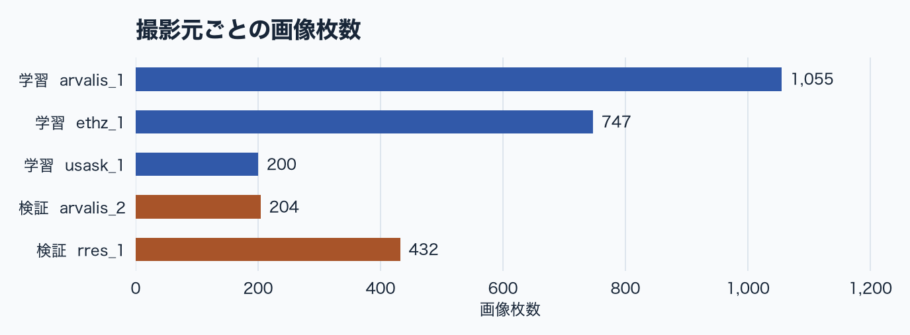
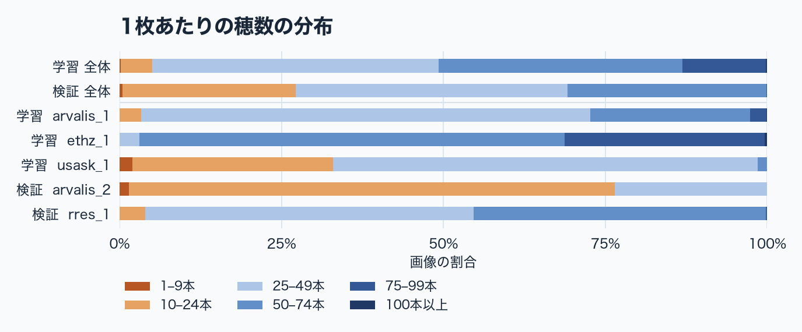

# 小麦データの分布

2026-11-14にKaggle公式データの固定分割（seed 42）を集計した。対象は注釈付きの学習2,002枚と探索用検証636枚。
元の固定分割では、注釈と撮影元がCSVにない49枚を除外している。最終確認用の分割は集計対象外。
「穂数」は画像内の正解枠の数。P90は画像ごとの穂数の90パーセンタイル（線形補間）。

## データ分割と集計の流れ

<picture>
  <source media="(prefers-color-scheme: dark)" srcset="figures/wheat-data-flow-dark.png">
  
</picture>

フロー図は [stack-diagram](https://github.com/caru-ini/stack-diagram/tree/9175bde8449cc8f5390d6eb72ecc2e1f5bfe21f3) で作成。アイコンは Kaggle と [Lucide](https://lucide.dev/)。

## 撮影元と穂数



| 分割 | 撮影元 | 画像枚数 | 注釈数 | 穂数の中央値 | P90 | 25本未満の画像 |
| --- | --- | ---: | ---: | ---: | ---: | ---: |
| 学習 | 全体 | 2,002 | 103,012 | 50 | 77 | 101 (5.0%) |
| 学習 | `arvalis_1` | 1,055 | 45,716 | 42 | 59 | 35 (3.3%) |
| 学習 | `ethz_1` | 747 | 51,489 | 69 | 82 | 0 (0.0%) |
| 学習 | `usask_1` | 200 | 5,807 | 29 | 41 | 66 (33.0%) |
| 検証 | 全体 | 636 | 24,415 | 37 | 61 | 173 (27.2%) |
| 検証 | `arvalis_2` | 204 | 4,179 | 21 | 27 | 156 (76.5%) |
| 検証 | `rres_1` | 432 | 20,236 | 47.5 | 63 | 17 (3.9%) |

## 1枚あたりの穂数の分布



表の値は各区間の画像枚数。

| 分割 | 撮影元 | 1–9本 | 10–24本 | 25–49本 | 50–74本 | 75–99本 | 100本以上 |
| --- | --- | ---: | ---: | ---: | ---: | ---: | ---: |
| 学習 | 全体 | 4 | 97 | 886 | 753 | 258 | 4 |
| 学習 | `arvalis_1` | 0 | 35 | 732 | 260 | 27 | 1 |
| 学習 | `ethz_1` | 0 | 0 | 23 | 490 | 231 | 3 |
| 学習 | `usask_1` | 4 | 62 | 131 | 3 | 0 | 0 |
| 検証 | 全体 | 3 | 170 | 267 | 195 | 1 | 0 |
| 検証 | `arvalis_2` | 3 | 153 | 48 | 0 | 0 | 0 |
| 検証 | `rres_1` | 0 | 17 | 219 | 195 | 1 | 0 |

## 正解枠の面積の分布

各正解枠の面積を画像面積で割り、既存の評価と同じ境界で区分した。表の値は各区間の注釈数。


| 分割 | 撮影元 | 0.2%未満 | 0.2%以上・1%未満 | 1%以上 |
| --- | --- | ---: | ---: | ---: |
| 学習 | 全体 | 8,861 | 82,110 | 12,041 |
| 学習 | `arvalis_1` | 1,768 | 36,863 | 7,085 |
| 学習 | `ethz_1` | 6,946 | 41,809 | 2,734 |
| 学習 | `usask_1` | 147 | 3,438 | 2,222 |
| 検証 | 全体 | 957 | 20,221 | 3,237 |
| 検証 | `arvalis_2` | 49 | 2,816 | 1,314 |
| 検証 | `rres_1` | 908 | 17,405 | 1,923 |

## 次のデータ実験

穂数25本未満の学習画像101枚は `arvalis_1` と `usask_1` に集中している。
この層を多めにサンプリングする試行では、学習ステップ数をそろえた通常サンプリングを比較元とする。
撮影元別と穂数別の誤検出・見逃しを記録する。検証の誤検出集計と仮説は[実験記録](experiments.md#学習検証データの分布)に記載。

## 追加データの取得と選定

最初の追加データは、GWHD 2021で新しく収録されたフランス・モンの `Arvalis_10`。
従来の固定検証にある `arvalis_2` は、同じ機関が別の圃場・時期に撮った `Arvalis_4` に対応する。
まず公式の2021年学習CSVに掲載された `Arvalis_10` のみを使う。
2021年版に含まれる2020年版の再収録画像や2021年の検証・テスト分割は追加対象から外した。
[論文の撮影セッション一覧](https://pmc.ncbi.nlm.nih.gov/articles/PMC8548052/#tab1)

| 追加画像 | 穂の注釈 | 25本未満 | 注釈が0本の画像 | 重複検査での除外 |
| ---: | ---: | ---: | ---: | ---: |
| 60 | 1,563 | 22 | 2 | 0 |

JPEG圧縮版の元データを使い、Kaggleで取得済みの訓練画像とサンプルテスト画像に対して、
ファイル名と64ビットの差分ハッシュ（ハミング距離4以下）で重複候補を確認した。
この検査範囲にはKaggleの非公開採点画像は含まれない。
追加画像は学習にだけ渡し、固定検証636枚と評価コードをそのまま使う。

データは CC BY 4.0。出典は David et al., *Global Wheat Head Detection 2021*、
JPEG圧縮は Yosuke Toda。今回の加工は撮影元の抽出と枠形式の変換。
[原版](https://zenodo.org/records/5092309) · [JPEG版](https://zenodo.org/records/8062267)

```bash
mkdir -p data/gwhd2021
curl -fL --continue-at - -o data/gwhd2021/gwhd2021jpg.zip \
  https://zenodo.org/api/records/8062267/files/gwhd2021jpg.zip/content
uv run --locked python scripts/prepare_gwhd2021_mons.py \
  data/gwhd2021/gwhd2021jpg.zip --output data/gwhd2021/mons
```

追加ZIPのSHA-256は `399cd67dc455bee217820dc66fdb0b1435c136a3fbaf83b2009bf10183f1ce0e`。

## 再集計

```bash
uv run --locked python scripts/profile_wheat_data.py --output outputs/data-profile/summary.json
uv run --locked python scripts/plot_wheat_data_profile.py outputs/data-profile/summary.json --output docs/figures
```

集計時の固定分割のSHA-256は `53da7a99e83694f2d0f706a19bb7f9675f23d29b767126c4dc16755aa777710f`。
