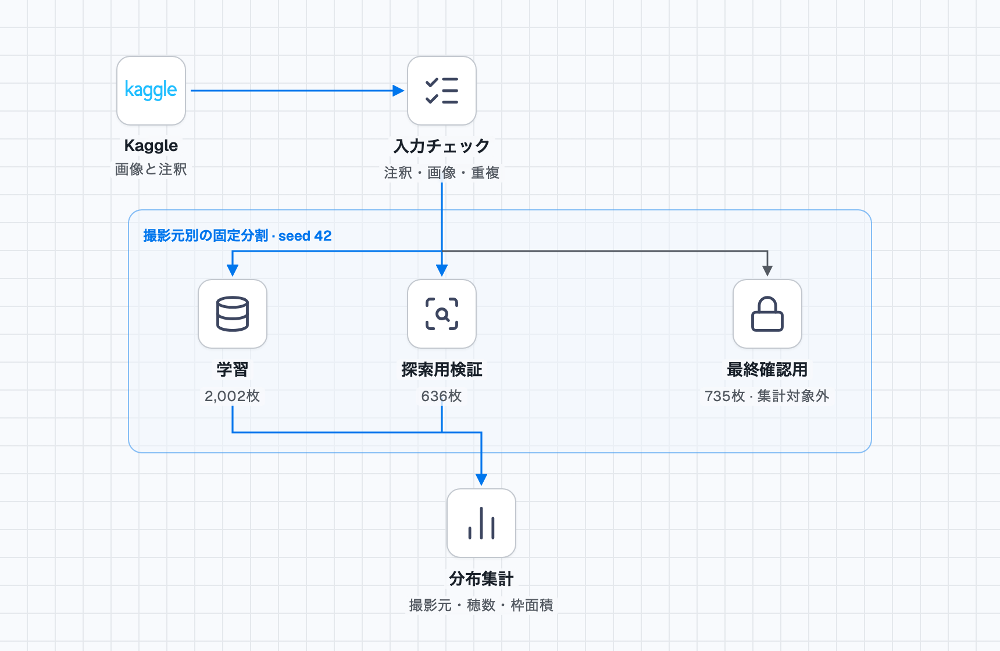
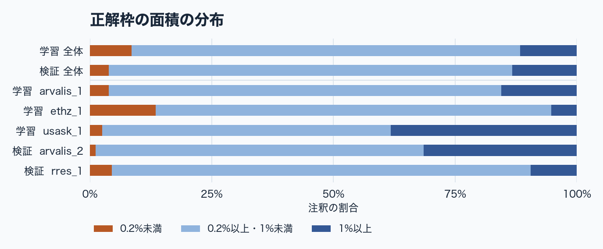
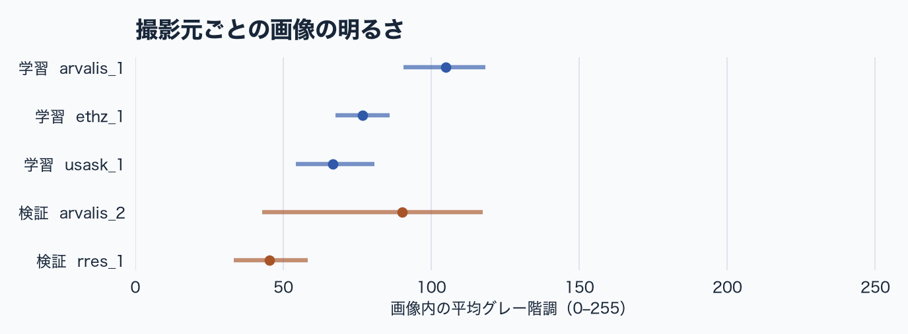
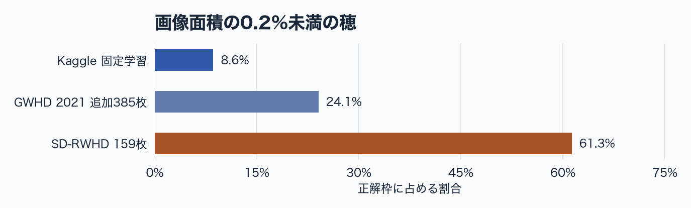

# 小麦データの分布

2026-11-14にKaggle公式データの固定分割（seed 42）を集計した。対象は注釈付きの学習2,002枚と探索用検証636枚。
元の固定分割では、注釈と撮影元がCSVにない49枚を除外している。最終確認用の分割は集計対象外。
「穂数」は画像内の正解枠の数。P90は画像ごとの穂数の90パーセンタイル（線形補間）。

## データ分割と集計の流れ

<picture>
  <source media="(prefers-color-scheme: dark)" srcset="figures/wheat-data-flow-dark.png">
  
</picture>

フロー図は [stack-diagram](https://github.com/caru-ini/stack-diagram/tree/9175bde8449cc8f5390d6eb72ecc2e1f5bfe21f3) で作成。アイコンは Kaggle と [Lucide](https://lucide.dev/)。

## 撮影元と穂数


| 分割 | 撮影元 | 画像枚数 | 注釈数 | 穂数の中央値 | P90 | 25本未満の画像 |
| --- | --- | ---: | ---: | ---: | ---: | ---: |
| 学習 | 全体 | 2,002 | 103,012 | 50 | 77 | 101 (5.0%) |
| 学習 | `arvalis_1` | 1,055 | 45,716 | 42 | 59 | 35 (3.3%) |
| 学習 | `ethz_1` | 747 | 51,489 | 69 | 82 | 0 (0.0%) |
| 学習 | `usask_1` | 200 | 5,807 | 29 | 41 | 66 (33.0%) |
| 検証 | 全体 | 636 | 24,415 | 37 | 61 | 173 (27.2%) |
| 検証 | `arvalis_2` | 204 | 4,179 | 21 | 27 | 156 (76.5%) |
| 検証 | `rres_1` | 432 | 20,236 | 47.5 | 63 | 17 (3.9%) |

## 1枚あたりの穂数の分布


表の値は各区間の画像枚数。

| 分割 | 撮影元 | 1–9本 | 10–24本 | 25–49本 | 50–74本 | 75–99本 | 100本以上 |
| --- | --- | ---: | ---: | ---: | ---: | ---: | ---: |
| 学習 | 全体 | 4 | 97 | 886 | 753 | 258 | 4 |
| 学習 | `arvalis_1` | 0 | 35 | 732 | 260 | 27 | 1 |
| 学習 | `ethz_1` | 0 | 0 | 23 | 490 | 231 | 3 |
| 学習 | `usask_1` | 4 | 62 | 131 | 3 | 0 | 0 |
| 検証 | 全体 | 3 | 170 | 267 | 195 | 1 | 0 |
| 検証 | `arvalis_2` | 3 | 153 | 48 | 0 | 0 | 0 |
| 検証 | `rres_1` | 0 | 17 | 219 | 195 | 1 | 0 |

## 正解枠の面積の分布

各正解枠の面積を画像面積で割り、既存の評価と同じ境界で区分した。表の値は各区間の注釈数。



| 分割 | 撮影元 | 0.2%未満 | 0.2%以上・1%未満 | 1%以上 |
| --- | --- | ---: | ---: | ---: |
| 学習 | 全体 | 8,861 | 82,110 | 12,041 |
| 学習 | `arvalis_1` | 1,768 | 36,863 | 7,085 |
| 学習 | `ethz_1` | 6,946 | 41,809 | 2,734 |
| 学習 | `usask_1` | 147 | 3,438 | 2,222 |
| 検証 | 全体 | 957 | 20,221 | 3,237 |
| 検証 | `arvalis_2` | 49 | 2,816 | 1,314 |
| 検証 | `rres_1` | 908 | 17,405 | 1,923 |

## 撮影元別の明るさ

2026-11-15に同じ固定分割を集計した。元のJPEGをPillowの `convert("L")` で
8bitグレー階調に変換し、各画像の全画素の平均を求めた。画像を等しく重み付けし、
画像平均の平均、中央値、P10、P90を撮影元別に集計した。分位点は線形補間。



| 分割 | 撮影元 | 平均 | 中央値 | P10 | P90 |
| --- | --- | ---: | ---: | ---: | ---: |
| 学習 | 全体 | 90.6 | 89.0 | 68.5 | 114.1 |
| 学習 | `arvalis_1` | 105.0 | 105.7 | 90.6 | 118.2 |
| 学習 | `ethz_1` | 76.8 | 77.0 | 67.7 | 86.0 |
| 学習 | `usask_1` | 66.8 | 67.5 | 54.1 | 80.7 |
| 検証 | 全体 | 59.7 | 50.2 | 34.2 | 106.5 |
| 検証 | `arvalis_2` | 90.1 | 98.2 | 42.9 | 117.4 |
| 検証 | `rres_1` | 45.4 | 45.0 | 33.3 | 58.2 |

`arvalis_2` と `arvalis_1` の明るい側は重なる一方、`arvalis_2` の暗い側は広い。
横反転だけのYOLOX-Sでは明るさを変えていない。以前のFaster R-CNNでは明るさ・
コントラスト・彩度に強度0.15の色ジッターを追加したが、同じconfidence 0.30で
`arvalis_2` は0.312789から0.312757、全体は0.512961から0.509165だった。

## 次のデータ実験

穂数25本未満の学習画像101枚は `arvalis_1` と `usask_1` に集中している。
この層を多めにサンプリングする試行では、学習ステップ数をそろえた通常サンプリングを比較元とする。
撮影元別と穂数別の誤検出・見逃しを記録する。検証の誤検出集計と仮説は[実験記録](experiments.md#学習検証データの分布)に記載。

## 追加データの取得と選定

最初の追加データは、GWHD 2021で新しく収録されたフランス・モンの `Arvalis_10`。
従来の固定検証にある `arvalis_2` は、同じ機関が別の圃場・時期に撮った `Arvalis_4` に対応する。
まず公式の2021年学習CSVに掲載された `Arvalis_10` のみを使う。
2021年版に含まれる2020年版の再収録画像や2021年の検証・テスト分割は追加対象から外した。
[論文の撮影セッション一覧](https://pmc.ncbi.nlm.nih.gov/articles/PMC8548052/#tab1)

| 追加画像 | 穂の注釈 | 25本未満 | 注釈が0本の画像 | 重複検査での除外 |
| ---: | ---: | ---: | ---: | ---: |
| 60 | 1,563 | 22 | 2 | 0 |

JPEG圧縮版の元データを使い、Kaggleで取得済みの訓練画像とサンプルテスト画像に対して、
ファイル名と64ビットの差分ハッシュ（ハミング距離4以下）で重複候補を確認した。
この検査範囲にはKaggleの非公開採点画像は含まれない。
追加画像は学習にだけ渡し、固定検証636枚と評価コードをそのまま使う。

データは CC BY 4.0。出典は David et al., *Global Wheat Head Detection 2021*、
JPEG圧縮は Yosuke Toda。今回の加工は撮影元の抽出と枠形式の変換。
[原版](https://zenodo.org/records/5092309) · [JPEG版](https://zenodo.org/records/8062267)

```bash
mkdir -p data/gwhd2021
curl -fL --continue-at - -o data/gwhd2021/gwhd2021jpg.zip \
  https://zenodo.org/api/records/8062267/files/gwhd2021jpg.zip/content
uv run --locked python scripts/prepare_gwhd2021_mons.py \
  data/gwhd2021/gwhd2021jpg.zip --output data/gwhd2021/mons
```

追加ZIPのSHA-256は `399cd67dc455bee217820dc66fdb0b1435c136a3fbaf83b2009bf10183f1ce0e`。

### GWHD 2021の追加学習候補を監査

2026-11-15に、論文の表1で2020年版への対応が空欄のセッションを、手元のJPEG版にある
`gwhd_2021/competition_train.csv` と照合した。該当する9セッションは435行。
`Arvalis_10` と `Arvalis_12` で同じ画像ファイル名が2つ見つかり、いずれもセッション間で枠が異なった。
両方の注釈を外したため、候補は **431枚・24,138枠**。初回作成時に60枚だったモンの候補は58枚になった。
[データセット論文の表1](https://pmc.ncbi.nlm.nih.gov/articles/PMC8548052/#tab1) · [JPEG版](https://zenodo.org/records/8062267)

| GWHD 2021のセッション | 候補画像 | 25本未満 | 小さい穂の枠 | 平均グレー階調 |
| --- | ---: | ---: | ---: | ---: |
| `Arvalis_7` | 24 | 0 | 245 | 61.2 |
| `Arvalis_8` | 20 | 0 | 214 | 96.2 |
| `Arvalis_9` | 32 | 0 | 566 | 88.3 |
| `Arvalis_10` | 58 | 21 | 70 | 65.2 |
| `Arvalis_11` | 60 | 0 | 197 | 69.8 |
| `Arvalis_12` | 27 | 0 | 243 | 67.7 |
| `NMBU_1` | 82 | 0 | 2,677 | 121.7 |
| `NMBU_2` | 98 | 10 | 1,366 | 97.9 |
| `ULiège-GxABT_1` | 30 | 0 | 135 | 35.3 |
| 全体 | 431 | 31 | 5,713 | 85.0 |

小さい穂は画像面積の0.2%未満の枠。候補では5,713 / 24,138枠（23.7%）、既存学習では
8,861 / 103,012枠（8.6%）。追加によって小さい穂と暗い撮影セッションは増えるが、
穂25本未満の画像は31枚（7.2%、うち穂0本は4枚）で、低密度の補強はモンなど一部に集中する。

再集計時はアーカイブのMD5 `92b0232d78420d1ddc1894fba89933b0` と、
学習CSVのSHA-256 `bc4cbc70b4c2998865d60cd2b5e9321b63ad0f04df736a1d370206476feddaf0` を確認する。
上記9セッションを抽出し、学習CSV全体で重複する `image_name` は全行を除外する。
`competition_val.csv` と `competition_test.csv` に候補のファイル名はなかった。
`scripts/prepare_gwhd2021_mons.py` の `parse_boxes` で全候補の枠が画像内に収まることを確認し、
`signature` で64bit差分ハッシュを比較した。手元のKaggle画像3,432枚（配布された学習画像と
サンプルテスト画像）とのファイル名一致またはハミング距離4以下は0件。
候補内の `NMBU_2` にはハミング距離0のペアが1組あり、JPEGのSHA-256と枠は異なった。
Kaggleの非公開採点画像との照合は未実施。

初回の比較には385枚を候補とする。431枚から、`NMBU_2` の近似ペア2枚と、
最終確認用の `arvalis_3` の一部と撮影地・年月が同じ `Arvalis_7`、`Arvalis_8` の44枚を保留する。
`arvalis_3` は2021年版の `Arvalis_5` と `Arvalis_6` に対応する。
保留画像を使う場合は近似ペアと撮影セッションの詳細を先に確認する。


## 追加データと背景サンプルの監査



| データ | 画像 | 正解枠 | 小さい穂の正解枠 | 注釈なしの画像 |
| --- | ---: | ---: | ---: | ---: |
| Kaggle固定学習 | 2,002 | 103,012 | 8,861（8.6%） | 0 |
| 監査済みGWHD 2021の追加分 | 385 | 21,720 | 5,228（24.1%） | 4（配布元の `no_box`） |
| 監査済みSD-RWHD | 159 | 18,787 | 11,516（61.3%） | 0 |

SD-RWHDは2023年6月に撮影された南ダコタの圃場データ。論文の全体は203画像、
配布ZIPの対応する画像と注釈は159組だった。四頂点から外接枠へ変換し、
画像端をまたぐ2,117枠を切り取り、完全に画像の外の3枠を除外した。
Kaggleのローカル学習・検証・確認画像と公開サンプル画像、SD-RWHD内を
64ビット差分ハッシュの距離4以下で比較したところ、除外する画像は0枚だった。
1画像の穂数は最小39、中央値76、最大312。配布はCC BY 4.0。
2020年コンペでは外部データの締切前告知が条件だったため、この2026年公開分は研究用に用意した。
[SD-RWHDの論文](https://pmc.ncbi.nlm.nih.gov/articles/PMC13529697/) ·
[配布元とライセンス](https://zenodo.org/records/20215489) ·
[Kaggle規約](https://www.kaggle.com/competitions/global-wheat-detection/rules)

| その他の公開データ | 確認結果 |
| --- | --- |
| SPIKE（2018） | 著者のZIPは画像355枚。ファイル上はpositive 315枚、test 30枚、negative 10枚。負例は葉や土の画像で、背景誤検出を測る補助評価に使う。 |
| WEDD（2019） | 作者がGWHDに統合済みと明記している。独立した追加画像としては扱わない。 |
| GWFSS（2025） | ラベル付き1,096枚がCC BY 4.0で公開。穂・葉・茎などのセマンティックマスクで、重なった穂の個別枠には追加処理が必要。 |
| BioS-Wheat（2025） | 論文では枠注釈付き5,696枚。掲載時点の記載はZenodoに公開予定で、対応する配布ZIPは確認できていない。 |

[SPIKE配布元](https://sourceforge.net/projects/spike-dataset/files/) ·
[SPIKE論文](https://pmc.ncbi.nlm.nih.gov/articles/PMC6236889/) ·
[WEDD作者の配布ページ](https://github.com/simonMadec/Wheat-Ears-Detection-Dataset) ·
[GWFSSデータカード](https://huggingface.co/datasets/GlobalWheat/GWFSS_v1.0) ·
[BioS-Wheat論文](https://www.nature.com/articles/s41598-025-28351-5)

Kaggleの固定学習2,002枚に、seed 42で拡大クロップを1回適用した。
切り出した1,020枚には穂の注釈がゼロの画像がなかった。
別途、学習画像の各辺の25–60%の窓を候補にし、正解枠の周囲に各辺の1.5%を
足した領域と重ならない窓を探索した。413枚から候補を1枚ずつ採取できた。
領域の条件は元の注釈に基づき、画像そのものはKaggleの入力から学習時に切り出す。

| 固定学習の撮影元 | 背景クロップ候補 |
| --- | ---: |
| `arvalis_1` | 244 |
| `ethz_1` | 26 |
| `usask_1` | 143 |

```bash
uv run --no-sync python scripts/prepare_sd_rwhd.py \
  data/sd-rwhd/1_SD-RWHD.zip --output data/sd-rwhd/prepared
uv run --no-sync python scripts/prepare_wheat_backgrounds.py \
  --output data/prepared/background-crops.json
```

SD-RWHDの配布ZIPのMD5は `e91153c30b4eb641a1b78923908b0b6b`。
変換済みアーカイブのSHA-256は `44f36d29bf481040dd03d41ac519320a1fb263b5d6608d5ca0d7045cbc666110`。
背景クロップの座標マニフェストのSHA-256は `9e6b55056f61ecc6ea70f2b7b5ef603b89c177c1ce7564cd96629962abe9a651`。

## 再集計

```bash
uv run --locked python scripts/profile_wheat_data.py --output outputs/data-profile/summary.json
uv run --locked python scripts/plot_wheat_data_profile.py outputs/data-profile/summary.json --output docs/figures
```

集計時の固定分割のSHA-256は `53da7a99e83694f2d0f706a19bb7f9675f23d29b767126c4dc16755aa777710f`。
