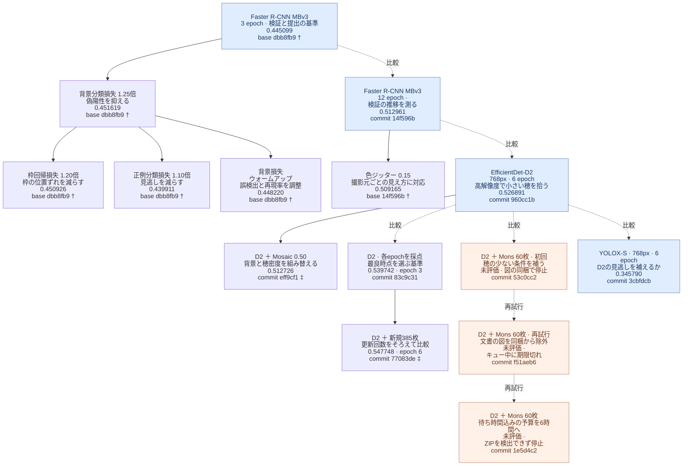
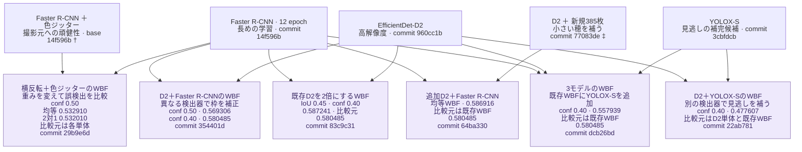
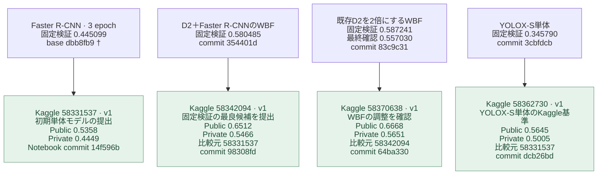
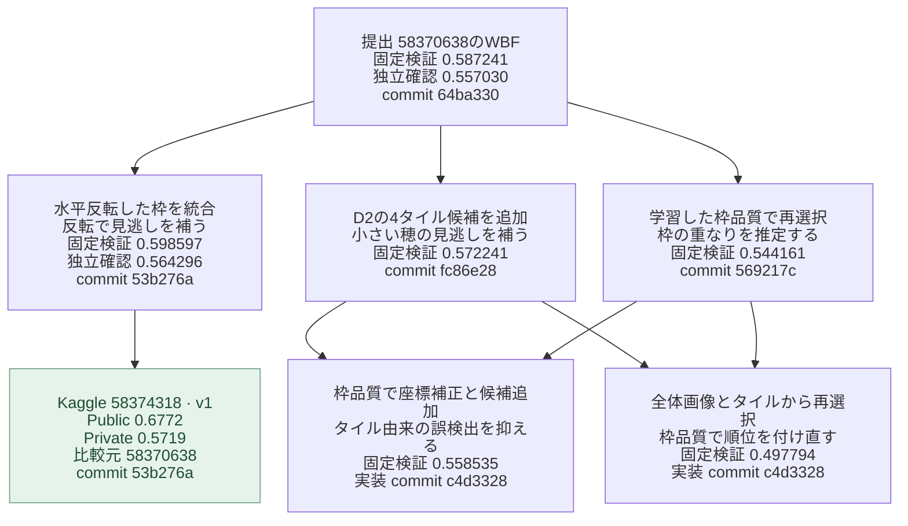
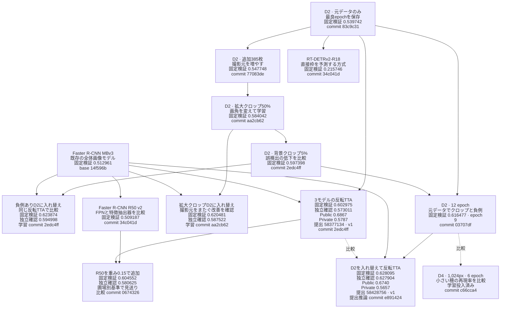

# 小麦検出の実験系譜

固定検証636枚を使った学習と、その重み・予測を使った推論を載せる。学習図の実線は
親のソース・設定からの派生、点線は別セッションでの比較や再試行を示す。
推論と提出の図では、実線が重み・予測の入力を示す。試行の仮説と集計の詳細は
[実験記録](experiments.md) と [データ分布](data-profile.md) を参照。

## 学習の分岐

スコアは全試行で共通の Wheat Image Precision、confidence 0.30。学習が完了する前に
止まった実行には停止理由を示す。

† 初期の一部試行はベースコミットに凍結済みの作業差分を加えて実行した。図の
`base` はGitの基点で、各試行のソースは末尾のハッシュで識別する。MLflowの
`experiment.ipynb` から凍結済みコードを読める。元がKaggle Scriptの試行には、
元の投入ファイルからコードを展開した閲覧用Notebookを保存した。
‡ 学習前に固定した試行コミット。ローカルの `refs/ml-loop/trials/` に加え、
GitHubの `codex/wheat-trials/<試行ID>` にも保存した。
`eff9cf1` は `d31623fdd5114e49-0002`、`77083de` は `1d692cda0f6e4cd2-0002` に対応する。

## アンサンブルへの合流

WBFの枠統合IoUは0.55。枠の統合で誤検出や重複が減るかを調べた。YOLOX-Sの追加候補は
出力confidence 0.40で既存のD2＋Faster R-CNNと比較した。

YOLOX-S単体はconfidence 0.30で小さい穂の再現率19.44%（IoU 0.50）だった。
同じconfidenceの誤検出6,521件と見逃し6,478件を踏まえ、総合スコアは0.345790。
既存WBFに加えた3モデル統合も全体で0.022546低く、撮影元別でも両方が低下した。
比較基準はD2＋Faster R-CNNのWBFを使う。

- [YOLOX-S 学習](http://localhost:5050/#/experiments/1/runs/4187c38c343e49c3a7dfdd9fd66dd85f) · [学習Notebook v1](https://www.kaggle.com/code/yutarotaro/wheat-train-yolox-s-6e-768-hflip-3c34d8001e01)
- [D2＋Faster R-CNN](http://localhost:5050/#/experiments/1/runs/3600138dbd634b52b2e050d204d9ee51) · [D2＋YOLOX-S](http://localhost:5050/#/experiments/1/runs/f7f52f79d74a41379b67bbc10e661c7c) · [3モデル](http://localhost:5050/#/experiments/1/runs/d5ffac91d7a1458eaf683447dd969548)

## Kaggleへの提出

- [初期単体の提出Notebook](https://www.kaggle.com/code/yutarotaro/wheat-baseline-late-20261114) · [D2＋Faster R-CNNの提出Notebook](https://www.kaggle.com/code/yutarotaro/wheat-infer-d2-mbv3-wbf040) · [YOLOX-S単体の提出Notebook](https://www.kaggle.com/code/yutarotaro/wheat-infer-yolox-s-6e-768-conf030)
- [Private 0.5651の提出Notebook](https://www.kaggle.com/code/yutarotaro/wheat-infer-d2-mbv3-wbf045-d2x2) · [MLflow提出Run](http://localhost:5050/#/experiments/1/runs/de5bd96bb3964629938b13ec172dd35a)

## 画像全体・反転・タイルの比較

- [水平反転TTAの提出Notebook](https://www.kaggle.com/code/yutarotaro/wheat-infer-d2-mbv3-hflip-tta) · [MLflow提出Run](http://localhost:5050/#/experiments/1/runs/75cbb24154074b9babdcfadec82cdb73)
- MLflowの推論Runの親は表示用に1件を選ぶ。アンサンブルで使った全学習RunはDescriptionと `model_input_run_ids` で確認できる。

## 拡大クロップと背景を使う検出器学習

初期試行のIDと凍結ソースハッシュ

| 試行 | ID | ソースSHA-256の先頭12桁 |
| --- | --- | --- |
| 3 epoch基準 | `10a1829d2fc84c67-0001` | `d0dfd016882d` |
| 背景分類損失 | `f5d6ac6937e943b8-0002` | `49e17622b751` |
| 枠回帰損失 | `f5d6ac6937e943b8-0003` | `e16db553fb66` |
| 正例分類損失 | `f5d6ac6937e943b8-0004` | `1b64af912199` |
| 背景損失のウォームアップ | `f5d6ac6937e943b8-0005` | `792f7c799877` |
| 色ジッター | `8fc98f3e68e8441a-0002` | `00e897919792` |

