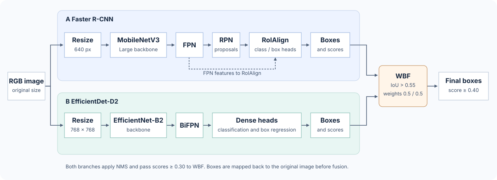

# 撮影元を分離した小麦穂検出における二検出器アンサンブルの評価

技術論文ドラフト · Global Wheat Detection · Kaggle提出 `58342094` · 2026年11月14日

[PDF版（A4・2段組）](figures/paper-58342094.pdf) · [English version](paper-58342094-en.md)

## 要旨

圃場で撮影された小麦画像では、撮影条件や穂の密度の違いが検出性能に影響する。Kaggle Global Wheat Detectionの学習画像を撮影元で分割し、MobileNetV3-Largeを用いたFaster R-CNNとEfficientDet-D2を個別に学習した。同一画像に対する両モデルの予測をWeighted Boxes Fusion（WBF）で統合し、学習時に使わなかった2撮影元の636枚で評価した。出力confidenceを0.40にそろえた比較で、検証スコアはFaster R-CNN単体の0.522629、EfficientDet-D2単体の0.544813に対し、統合後は0.580485だった。EfficientDet-D2単体に対して、IoU 0.50での誤検出と重複は減少したが、見逃しは増加した。Kaggleの終了後提出ではPublic 0.6512、Private 0.5466を得た。撮影元間のスコア差と小さい穂の低い再現率が残る。

## 1 はじめに

小麦の穂を画像上で検出すると、圃場での穂数や密度を調べられる。屋外画像では穂の重なり、背景、撮影装置、撮影時の生育段階が変わる。Global Wheat Head Detection（GWHD）は複数の機関・圃場で収集した画像と正解枠を提供しており、このような条件差を含む検出の評価に使われている。 [1](#references)

本報告では、領域候補を分類・補正する二段階検出器と、特徴マップ上のアンカーを直接分類・補正する一段階検出器を組み合わせる。主な問いは、同じ画像・同じ出力閾値で比較したときに、枠の統合によって検証スコアが上がるか、その変化が誤検出と見逃しにどう現れるかである。 [3–7](#references)

## 2 データと評価方法

### 2.1 撮影元による分割

Kaggleの `train.csv` と対応する画像を使用した。注釈・撮影元がCSVにない49枚を除き、同じ撮影元と完全一致する画像を分割間にまたがせないよう、シード42でグループ分割した。検証は636枚、別に最終確認用735枚を確保した。最終確認用735枚の採点は本報告の時点で行っていない。

| 分割 | 画像数 | 撮影元 |
| --- | ---: | --- |
| 学習 | 2,002 | `arvalis_1` 1,055枚、`ethz_1` 747枚、`usask_1` 200枚 |
| 探索用検証 | 636 | `arvalis_2` 204枚、`rres_1` 432枚 |
| 最終確認用 | 735 | 撮影元単位で確保 |

画像内の穂数は注釈枠の数とした。穂数の中央値は学習50本、検証37本だった。25本未満の画像は学習101枚（5.0%）、検証173枚（27.2%）で、`arvalis_2` では156枚（76.5%）だった。 [データ分布の集計](data-profile.md)

### 2.2 評価指標

ローカル検証では、画像ごとにconfidenceの降順で予測枠を並べ、未対応の正解枠のうちIoUが最大のものに対応づける。IoUが閾値を超えた組を真陽性とし、正解枠は一度だけ対応づける。各画像・各閾値で `TP / (TP + FP + FN)` を計算し、IoU閾値0.50、0.55、0.60、0.65、0.70、0.75と全画像で平均した。重複検出もこの式のFPに含む。誤り分析では、未対応の予測のうち既に対応済みの正解枠と重なるものを重複として別に数えた。小さい穂は正解枠の面積が画像面積の0.2%未満のものと定義し、IoU 0.50で再現率を算出した。KaggleのPublic・Privateは提出サービスが返した値を報告する。 [2](#references) · [評価実装](../src/wheat/metric.py)

## 3 提案手法 Proposed method



**図1　二検出器の構成と推論経路。** 実線は画像、特徴、領域候補または予測枠の流れを示す。Faster R-CNNの破線は、領域候補に対応する特徴をFPNからRoIAlignへ渡す経路を示す。

### 3.1 MobileNetV3-Large Faster R-CNN

枝AではTorchVisionの `fasterrcnn_mobilenet_v3_large_fpn` を使う。MobileNetV3-Largeで特徴を抽出し、FPNで複数解像度の特徴を構成する。RPNが領域候補を出し、RoIAlignがFPNから各領域の特徴を取り出す。分類・回帰ヘッドが穂のスコアと補正後の枠を出力する。COCO事前学習済みの検出器を初期値に、最終予測器を小麦穂と背景の2クラスへ交換した。入力サイズの設定値は640 pxとした。 [3–5](#references)

### 3.2 EfficientDet-D2

枝Bでは `tf_efficientdet_d2` を使う。画像を768 × 768に変換し、EfficientNet-B2の特徴をBiFPNで双方向に融合する。各スケールの分類・回帰ヘッドがアンカーごとに穂のスコアと枠を出力する。事前学習済みの検出器を初期値に、小麦穂1クラスで学習した。 [6](#references)

### 3.3 学習と予測の統合

両モデルを同じ2,002枚で個別にファインチューニングした。KaggleのTesla T4を使用し、シード42、バッチ4、AdamW、学習率0.0001、学習時の水平反転確率0.50を共通にした。Faster R-CNNは12 epoch、D2は6 epochの最終チェックポイントを使用した。この提出構成の学習にはKaggleの訓練画像を使用した。

推論では、各検出器のNMS後のconfidence 0.30以上の枠を元画像の座標に戻し、画像幅・高さで正規化する。WBFは重み0.5ずつで、現在の統合枠とのIoUが0.55を超える候補をまとめ、枠座標を各予測のconfidenceとモデル重みの積で加重平均する。統合枠のconfidenceには `ensemble-boxes 1.0.9` の `box_and_model_avg` を使う。均等重みで各モデルから1枠ずつ採用される場合は両者のconfidenceの平均となり、片方だけから1枠が出た場合は元のconfidenceの半分となる。元画像の座標へ戻した枠のうち統合confidence 0.40以上を採用し、提出形式へ変換する。confidence 0.40は固定検証上の候補の中で選んだ。 [7](#references) · [提出設定](../configs/submission-d2-mbv3-wbf040.json)

## 4 結果

### 4.1 撮影元を分離した検証

固定検証636枚で出力confidenceを0.40にそろえると、WBFは全体でD2単体を0.035672上回った。撮影元別でもそれぞれの最良単体を上回った。`arvalis_2` の統合後のスコアは0.378352、`rres_1` は0.675937だった。

| 推論方法 | 全体 | `rres_1`（432枚） | `arvalis_2`（204枚） |
| --- | ---: | ---: | ---: |
| MobileNetV3-Large Faster R-CNN | 0.522629 | 0.611282 | 0.334894 |
| EfficientDet-D2 | 0.544813 | 0.650899 | 0.320160 |
| **両モデルのWBF** | **0.580485** | **0.675937** | **0.378352** |

同じIoU 0.50で予測の内訳を比較すると、D2単体からWBFへ変えたとき、重複を除く誤検出は2,619件から1,688件に、重複は108件から48件に減った。見逃しは4,663件から5,094件へ増えた。小さい穂957本に対する再現率はD2単体9.82%からWBF 5.96%へ下がった。

| 推論方法 | 誤検出（重複を除く） | 重複 | 見逃し | 小さい穂の再現率 |
| --- | ---: | ---: | ---: | ---: |
| MobileNetV3-Large Faster R-CNN | 3,151 | 174 | 4,901 | 64 / 957（6.69%） |
| EfficientDet-D2 | 2,619 | 108 | 4,663 | 94 / 957（9.82%） |
| 両モデルのWBF | 1,688 | 48 | 5,094 | 57 / 957（5.96%） |

### 4.2 Kaggleの終了後提出

学習Notebookと提出Notebookを分離した。提出時はネット接続を無効にし、2つのチェックポイントと依存wheelをSHA-256で確認した。Kaggleのサンプル10枚に対してCSVの生成と形式を確認し、提出Notebook v1を使って採点した。

| 提出 | 構成 | Public | Private |
| --- | --- | ---: | ---: |
| `58331537` | MobileNetV3-Large Faster R-CNN、3 epoch、confidence 0.30 | 0.5358 | 0.4449 |
| `58342094` | Faster R-CNN 12 epochとD2 6 epochのWBF、confidence 0.40 | **0.6512** | **0.5466** |
| 差 | 後者 − 前者 | +0.1154 | +0.1017 |

## 5 考察と限界

閾値をそろえた固定検証では、枠統合後に誤検出と重複が減り、見逃しは増えた。この結果は、片方しか捉えなかった候補がconfidence調整で落ちやすい挙動と整合する。小さい穂での低い再現率を考えると、片方の検出器だけが高いconfidenceを付けた枠の扱いは改善余地がある。なお、統合前のconfidenceは検出器ごとに校正していない。

撮影元による差は大きく、学習と検証で穂数の分布も異なった。評価した検証撮影元は2つで、穂数・背景・機材など個々の要因の寄与は切り分けられていない。confidenceを選んだ分割でスコアも報告しているため、0.580485は探索用検証の結果である。独立したローカル最終確認と複数シードでの再評価が今後の課題となる。モンの追加画像を使う試行は、この提出時点の結果には含めていない。

Kaggleでは初回提出からPrivateが0.1017改善した。この差には、学習epoch数、モデル構成、confidenceの変更が含まれる。2020年の1位解法では複数モデル、外部データ、推論時拡張、擬似ラベルも使われており、公開記録のPrivate 0.6897との単純なスコア差は0.1431である。 [8–9](#references)

## 6 再現性

| 対象 | 実行またはコード |
| --- | --- |
| 固定分割 | seed 42、分割マニフェストのSHA-256 `53da7a99e83694f2d0f706a19bb7f9675f23d29b767126c4dc16755aa777710f` |
| Faster R-CNN学習 | `8fc98f3e68e8441a-0001` · [Kaggle Notebook v1](https://www.kaggle.com/code/yutarotaro/wheat-train-mbv3-12e-640-hflip-ef473611c538) |
| D2学習 | `d31623fdd5114e49-0001` · [Kaggle Notebook v1](https://www.kaggle.com/code/yutarotaro/wheat-train-effdet-d2-6e-768-b995f1851fd0) |
| 提出推論 | ソース `98308fd` · [Notebook v1](../notebooks/submission-d2-mbv3-wbf040.ipynb) · [Kaggle上のNotebook](https://www.kaggle.com/code/yutarotaro/wheat-infer-d2-mbv3-wbf040) |

固定検証での統合は、両学習の保存済み予測から再実行できる。

```bash
uv run --script scripts/ensemble_predictions.py \
  .loop-wheat/8fc98f3e68e8441a/artifacts/8fc98f3e68e8441a-0001 \
  .loop-wheat/d31623fdd5114e49/artifacts/d31623fdd5114e49-0001 \
  --confidence 0.40 --iou 0.55 --output .loop-wheat/ensemble/paper-58342094
```

## References

1. David E. et al. Global Wheat Head Detection (GWHD) Dataset. *Plant Phenomics*, 2020. [DOI](https://doi.org/10.34133/2020/3521852)
2. Kaggle. Global Wheat Detection competition. [Evaluation](https://www.kaggle.com/competitions/global-wheat-detection/overview/evaluation)
3. Howard A. et al. Searching for MobileNetV3. *ICCV*, 2019. [arXiv](https://arxiv.org/abs/1905.02244)
4. Lin T.-Y. et al. Feature Pyramid Networks for Object Detection. *CVPR*, 2017. [arXiv](https://arxiv.org/abs/1612.03144)
5. Ren S. et al. Faster R-CNN. *NeurIPS*, 2015. [arXiv](https://arxiv.org/abs/1506.01497)
6. Tan M., Pang R., Le Q. V. EfficientDet. *CVPR*, 2020. [arXiv](https://arxiv.org/abs/1911.09070)
7. Solovyev R., Wang W., Gabruseva T. Weighted Boxes Fusion. 2021. [arXiv](https://arxiv.org/abs/1910.13302) · [実装](https://github.com/ZFTurbo/Weighted-Boxes-Fusion)
8. David E. et al. Global Wheat Head Detection Challenges. *Plant Phenomics*, 2023. [DOI](https://doi.org/10.34133/plantphenomics.0059)
9. DungNB. 1st Place Solution for Global Wheat Detection. [公開コードとスコア](https://github.com/dungnb1333/Global-Wheat-Dection-1st-Place#pseudo-labeling)
